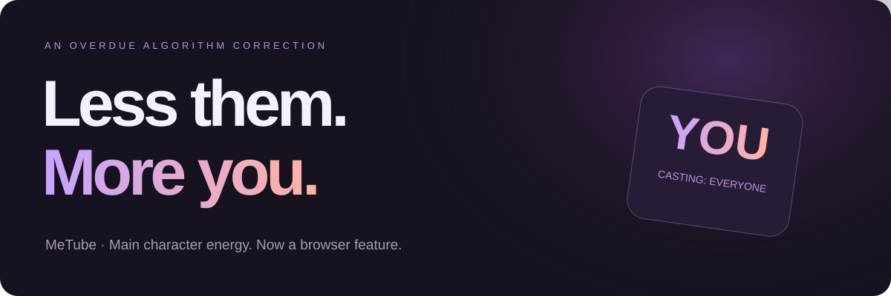

# MeTube

### The algorithm has recommended everyone except the obvious choice.



**Millions of videos. Somehow, barely any about you. Let's fix that embarrassing oversight.**

MeTube replaces the main face in YouTube thumbnails with yours. Same video. Same thumbnail. A much more qualified main character.

A long beard? Yours now. Flowing hair? You contain multitudes. Interview with a director? Finally, someone interesting.

**Private beta. Unpacked Chrome / Comet extension. Bring your own fal key and unreasonable self-confidence.**

## Your debut

1. Download this repo or the extension ZIP and unzip it.
2. Open `chrome://extensions` in Chrome or Comet. Turn on **Developer mode**.
3. Click **Load unpacked** and select the **`extension`** folder, the one containing `manifest.json`.
4. Open MeTube's **Details → Extension options**. Paste your [fal API key](https://fal.ai/dashboard/keys), then **Save**. Choose your thumbnail limit and concurrency here too.
5. Open YouTube. Click **Main character settings** or drag a photo onto the page.
6. Click **Crown me · Use this photo**, then **Make it all about me**.

The first results take time. Local face detection runs first; Krea 3 edits are queued through fal. Subsequent identical requests can reuse saved results.

Use a clear, well-lit photo with one face. A relaxed expression and visible facial features beat a heroic camera angle. JPEG, PNG and WebP work; HEIC support depends on the browser. If it refuses your HEIC, export it as JPEG. Your ego will survive the conversion.

## The part where you show someone

The floating **Before / After** switch changes the thumbnails already generated on the page instantly. No reload. No new generation charge from the switch.

- **Before:** a depressing universe in which other people exist.
- **After:** editorial standards have been restored.
- **Pause my takeover:** stop starting new feed work. Requests already submitted to fal may still finish and be billed.
- **Clear photo:** remove the saved reference, pause the feed and restore the original visible thumbnails. Your fal key stays saved.
- **Admire one thumbnail:** optional single-image preview that pauses new feed work while you inspect it. You can enable the full feed without doing this first.

For a fresh demo: **Clear photo → drop photo → Crown me → Make it all about me → Before / After**.

The switch covers thumbnails MeTube has processed in the current page. It doesn't edit videos, change their creators, or convince your friends you've actually been on every podcast.

## A joke with a GPU bill

This uses **Krea 3 editing through fal**, not an unlimited free filter. Each new edit can cost money. Actual charges depend on fal's current model pricing and image sizes. Keep the thumbnail limit low for demos. The worker also caps new submissions in a fixed one-hour window, defaulting to the thumbnail limit (12 if unset), across tabs and SPA navigation. Reservations count conservatively even if a later request fails. It is a request-count cap, not a dollar limit.

MeTube saves request receipts before waiting for results. If a job times out, retrying resumes the saved request. It avoids silently submitting another paid job when a submission's outcome is unknown. It does not promise refunds or cancel jobs already accepted by fal. For failed or unknown outcomes, open **Extension options → Saved request recovery**, check fal history, and explicitly acknowledge duplicate-charge risk before forgetting a receipt. Unknown requests cannot always be resumed.

## Where your face goes

Your reference and fal key are saved in this browser's local extension storage. Generated thumbnails are cached locally in IndexedDB. They are not included in this repo or ZIP.

Face / hair / hand detection runs locally using bundled MediaPipe models. When you start a generation, the head-region crop and reference face are sent to **fal / Krea**. Clearing the photo removes the active local reference; it does not delete fal's records, pending requests, or the local image cache, including source thumbnails and preview masks. Use **Extension options → Clear cache** to remove cached edits.

There is no MeTube backend, analytics service, or shared account. Keep your key private. Use photos you have permission to use.

## Extremely important limitations, tragically about other people

- It currently chooses one prominent face, not every person in a group shot.
- It keeps the source hairstyle and beard intentionally. The result should be you in costume; occasionally it is your suspiciously employed cousin.
- Tiny faces, profiles, glasses, foreground objects and lettering across faces can still confuse it.
- Text-occluded faces use an experimental segmentation fallback. Background and protected pixels are composited back locally, but detection is fallible.
- YouTube changes its layouts. This is a developer extension, not a Chrome Web Store release.
- Browser rendering and Krea's identity fidelity vary. Review the results before declaring yourself universally castable.

## For the people who read the source

```text
extension/       Load this folder unpacked
  compare.js     Local before/after state and thumbnail restoration
  content.js     YouTube tiles, demo controls, photo changes
  photo-overlay.js  The monument to your face
  background.js  Queue receipts, cache and fal requests
  vision-engine.mjs  Automatic head region + protected-pixel compositing
  vision/        Bundled MediaPipe runtime and models
 tests/          No-provider regression checks
```

Run the local checks with Node.js:

```sh
npm ci
npm test
```

Runtime needs no npm install or remote script loading. The bundled vision assets make the extension download fairly large. Krea requests require internet access and your own fal account.

## Reviewed, even though the ego said it was unnecessary

[Claude Sonnet 5.5 approved the private beta](docs/REVIEW.md) after three review passes and fixes. The clean-package checks pass: 8 Node cases plus 13 worker assertions. The review is static source review; provider quality still depends on the image and Krea.

## Private means private

This repository starts private. Matthew decides if and when it becomes public. Before a public release, choose the project license, confirm the original ZIP's redistribution rights and bundled model terms, and review the [release notes](docs/RELEASE.md). Third-party notices are in [THIRD_PARTY.md](THIRD_PARTY.md).

Built for the one person the internet has been criminally under-covering.

You, obviously.
